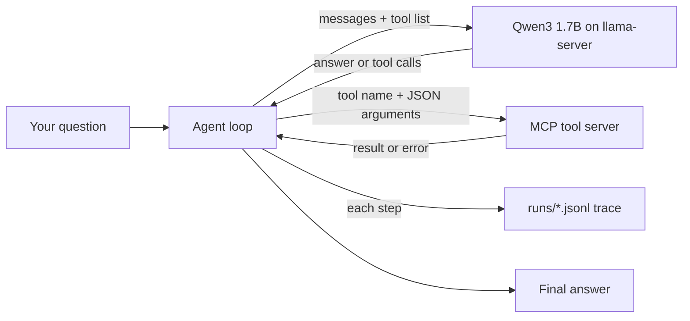

# Agent Lab

Learn how an AI agent works by building one, step by step, on your own computer.

Agent Lab is a small, fully local project. A small language model (Qwen3 1.7B) runs on your PC through
`llama-server`. A tool server that you can read in one sitting gives the model nine simple tools over MCP. Then
the same agent is built twice:

- **by hand**: a plain Python `for` loop on LiteLLM, where every moving part is visible code;
- **with LangGraph**: the same agent as a graph, so you can see what a framework does for you.

Six short lessons walk from "send one prompt" to "a full agent that uses tools through MCP". Every lesson that
uses the model also runs with `--fake` (a scripted model), so you can learn the flow before you download anything.

Nothing leaves your computer: no cloud model, no API key, no internet tools.

## What you will learn

| Idea | What it means | Where to see it |
| --- | --- | --- |
| Model API | A chat request is a list of messages; the reply is a message plus token counts. | lesson 01, `src/agent_lab/model.py` |
| Tool calling | The model never runs code. It *asks* for a tool by name with JSON arguments; your code runs it and sends the result back. | lesson 02 |
| Structured output | Ask for JSON that matches a schema (from a Pydantic model), check it, and give the model one chance to fix it. | lesson 03 |
| Agent loop | Repeat: ask the model, run the tools it asks for, add the results. Stop on an answer or at a step limit. | lesson 04, `src/agent_lab/agent/hand.py` |
| MCP | A standard protocol to offer tools, resources and prompts to any agent. Here over stdio: the agent starts the server as a child process. | lesson 05, `src/agent_lab/mcp_server.py` |
| Frameworks | LangGraph owns the loop: a `model` node, a `tools` node and one conditional edge. | lesson 06, `src/agent_lab/agent/graph.py` |
| Traces | Every step is saved as one JSON line, so you can replay a run and see why the agent did what it did. | `runs/`, `viewer/viewer.html` |

Every module and public function has a plain-English comment, written for a beginner.

## Quick look without a model

You need only `uv` (a Python project tool, from `docs.astral.sh/uv`). In the project folder:

```
uv sync
uv run python lessons/04_agent_loop.py --fake
```

The fake model follows a script, so you see the full agent loop (model reply, tool call, tool result, final answer)
in a few seconds. The tools are real: the agent multiplies 17 by 23 and writes the answer to
`sandbox/notes/result.md`.

## Setup

1. Install `uv` (see `docs.astral.sh/uv`). It installs the right Python (3.12) for you.
2. Run `uv sync` in the project folder.
3. Get `llama-server` from llama.cpp (`github.com/ggml-org/llama.cpp`, Releases; the CUDA build for an NVIDIA GPU, else the CPU build).
4. Download the model file `Qwen3-1.7B-Q8_0.gguf` (1.8 GB) from the Hugging Face repo `Qwen/Qwen3-1.7B-GGUF`.
5. Copy `agent-lab.example.toml` to `agent-lab.toml`.
6. Set `llama_server` and `model` in `agent-lab.toml` to the real paths on your computer.
7. Run `uv run agent-lab model start`, then `uv run agent-lab model status`.
8. Run `uv run python lessons/01_model_call.py`.
9. Run `uv run agent-lab model stop` when done; the model uses GPU memory while it runs.

`agent-lab.toml` is ignored by git, so your own paths stay private. Every setting can also come from an environment
variable, for example `AGENT_LAB_PORT=8091`.

Model check: the SHA-256 of `Qwen3-1.7B-Q8_0.gguf` is
`061b54daade076b5d3362dac252678d17da8c68f07560be70818cace6590cb1a`.

## Lessons

Lessons 01 to 04 and 06 run with `--fake` (no model needed) or live. Lesson 05 does not use the model.
Each lesson has a matching tab in the interactive diagram `plan/03-architecture.html` (open it in a browser; keys
1-6 pick a flow, the arrow keys step through it).

| Lesson | What you learn | Diagram |
| --- | --- | --- |
| `lessons/01_model_call.py` | Send a prompt to the model and read its reply and token counts. | plan/03-architecture.html, tab 1 |
| `lessons/02_tool_call.py` | See the model ask for a tool, run it, and send the answer back. | plan/03-architecture.html, tab 2 |
| `lessons/03_structured_output.py` | Ask for a JSON study card, check its shape, and allow one correction. | plan/03-architecture.html, tab 3 |
| `lessons/04_agent_loop.py` | Watch the hand-written agent solve a two-tool task step by step. | plan/03-architecture.html, tab 4 |
| `lessons/05_mcp_client.py` | Start the MCP server, list what it offers, call a tool, read a resource. | plan/03-architecture.html, tab 5 |
| `lessons/06_langgraph_agent.py` | Solve lesson 04's task again with LangGraph and compare. | plan/03-architecture.html, tab 6 |

A good way to learn:

1. Run a lesson with `--fake` and read its output.
2. Read the lesson file from top to bottom (each is short and commented).
3. Run it live and compare. The small real model sometimes picks a wrong tool or argument; that is useful to see.
4. Open the saved trace in the viewer (below).

## How the agent works



The loop in `src/agent_lab/agent/hand.py`, in short:

1. Send the system prompt, the question and the tool list to the model.
2. If the reply has no tool calls, it is the answer: stop.
3. Else, for each tool call: check the arguments against the tool's JSON schema, run the tool through MCP, and add
   the result as a `role: tool` message with the same call id.
4. Go back to step 1. Stop after `max_steps` model calls (default 6), so a confused model cannot loop forever.

Bad arguments do not crash the loop. The error text goes back to the model as the tool result, so it can try again.

The LangGraph version (`src/agent_lab/agent/graph.py`) does the same with a `StateGraph`. It uses the same model,
the same tools and the same trace format, so you can compare the two files line by line.

## The tools (MCP server)

`src/agent_lab/mcp_server.py` is a FastMCP server. The agent starts it as a child process and talks to it over
stdio (no network port).

| Tool | What it does |
| --- | --- |
| `add`, `multiply` | Simple maths. |
| `convert_units` | Converts length (mm to mi), mass (g, kg, lb) and temperature (C, F, K). |
| `now` | The current time in a time zone (default UTC). |
| `days_between` | Days between two dates (YYYY-MM-DD). |
| `write_note`, `read_note`, `list_notes` | Notes in `sandbox/notes/`, the only folder a tool may write. Names with `..`, slashes or drive letters are refused. |
| `search_docs` | Searches the small Markdown corpus in `docs_corpus/`. |

A tool error (an unknown unit, a bad date) comes back as a clear message that names the valid values, so the model
can correct itself.

The server also offers one **resource** (`docs://{name}`, a document from the corpus) and one **prompt**
(`explain_tool`), so lesson 05 can show all three MCP building blocks.

## Chat, traces and the viewer

- `uv run agent-lab chat --engine hand` or `--engine graph` starts a chat with either agent. Add `--fake` to try
  it without the model.
- Each run is saved to `runs/<id>.jsonl`, one JSON line per event (`user`, `model_request`, `model_reply`,
  `tool_call`, `tool_result`, `final`, `limit`, `error`).
- Open `viewer/viewer.html` in a browser and pick a trace file to replay a run. The page reads the file locally;
  it loads nothing from the internet.

## Commands

- `uv run agent-lab model start|status|stop` starts, checks, or stops the model server.
- `uv run agent-lab chat --engine hand|graph [--fake]` starts a chat with either agent.
- `uv run python lessons/<file> [--fake]` runs a lesson.
- `uv run pytest` runs the offline tests (no model server needed).
- `uv run pytest -m live -n 0` runs live tests. Start the model server first.

## Tests

- **Offline tests** (`uv run pytest`): about 190 tests that need no model, GPU or network. A socket guard fails any
  test that tries to reach the internet. They run in parallel and take a few minutes, mostly to start Python and
  the MCP server many times.
- **Live tests** (`uv run pytest -m live -n 0`): 11 smoke tests against the real model. They run one at a time
  because they share one model server.

## Where things are

- `src/agent_lab/`: the agent code. `model.py` (model calls), `mcp_server.py` and `mcp_client.py` (tools over
  MCP), `tools_schema.py` (tool format and argument checks), `agent/hand.py` and `agent/graph.py` (the two
  agents), `trace.py`, `cli.py`, `settings.py`, `model_server.py`, `fakes.py` (the scripted model).
- `lessons/`: the six lessons.
- `viewer/`: the trace viewer page.
- `docs_corpus/`: the small documents that `search_docs` searches.
- `plan/`: the interactive architecture diagram and the planning notes.
- `docs/`: requirements, architecture, decisions, dependencies, task specs.
- `tests/`: offline and live tests.
- `sandbox/notes/`, `runs/`, `.agent-lab/`: created at run time and ignored by git.

## Platform notes

- Built and tested on Windows 10 with an NVIDIA GPU (4 GB is enough for this model).
- `agent-lab model start|stop` uses Windows process commands. On macOS or Linux, the lessons, the `--fake` mode
  and the offline tests should work, but this is not tested; start `llama-server` yourself with
  `llama-server -m <model.gguf> --jinja -ngl 99 -c 8192 --host 127.0.0.1 --port 8090`.
- No GPU: use the CPU build of llama.cpp and leave out `-ngl 99`. It is slower but should work for this small
  model (not tested here).

## Troubleshooting

- **"cannot reach the model"**: the model server is not running. Run `uv run agent-lab model start`, or use
  `--fake`.
- **Port 8090 is busy**: set `port` in `agent-lab.toml` (or `AGENT_LAB_PORT`).
- **The model picks a wrong tool or gives a strange answer**: expected with a 1.7B model. Read the trace to see
  which step went wrong; that is part of the lesson.
- **Model start fails**: read `.agent-lab/model.log`, and check the two paths in `agent-lab.toml`.

## How this project was built

Agent Lab was built by AI coding agents under human review, as a test of an AI development workflow: Claude Code
planned and reviewed each task, and OpenAI Codex wrote the code. The planning and review files are kept so you can
see how an AI-built project is planned and checked:

- `plan/`: the first idea, the research, the architecture diagram and the approval of the plan.
- `docs/REQUIREMENTS.md`: every requirement (REQ-###) with test criteria.
- `docs/DECISIONS.md`: each decision, why it was made, and who made it.
- `docs/specs/`: one task spec per feature (AL-F-###) and per technical task (AL-T-###).
- `docs/exec-plans/`: the four build phases.
- `feature_list.json` and `progress.md`: the feature status and the build log.
- `AGENTS.md`, `CLAUDE.md`: the rules the coding agents followed.

## License

MIT, see `LICENSE`. The model (Qwen3) and the libraries have their own licenses, listed in `docs/DEPENDENCIES.md`.
